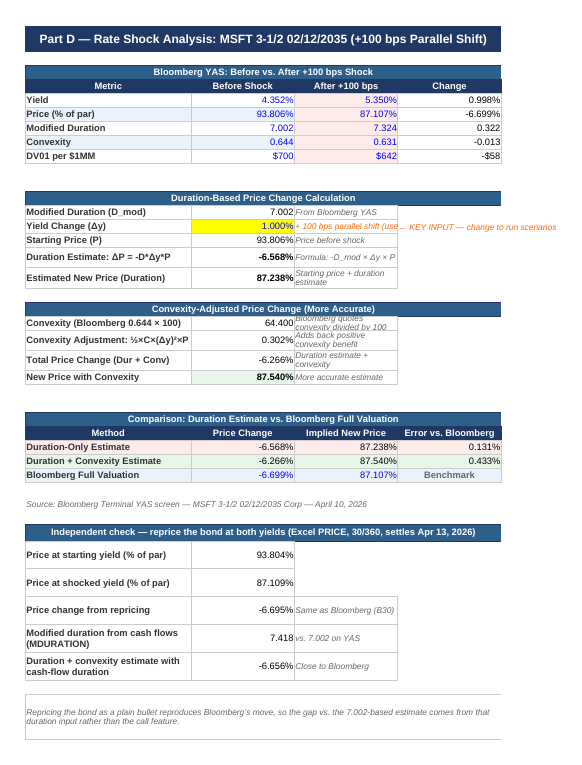
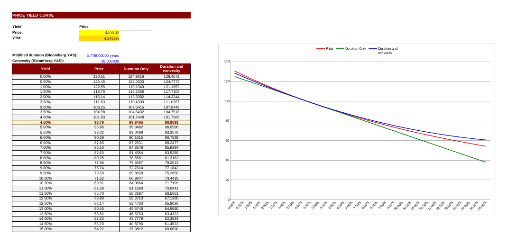

# Fixed Income & Bond Risk Analysis (Bloomberg Terminal)

Two fixed income projects from **FIN 675, Spring 2026 (UMass Dartmouth)**, built from Bloomberg Terminal data (BTMM, GP, DES, YAS) and modeled in Excel. They cover:

- the shape and movement of the U.S. Treasury yield curve
- interest rate risk on a 10-year Treasury
- credit spreads on a AAA corporate bond, plus a +100 bp rate shock
- a full yield, call and duration analysis of an Apple callable senior note

| File | What it covers |
|---|---|
| [`FIN675_Treasury_Corporate_Bond_Analysis.xlsx`](FIN675_Treasury_Corporate_Bond_Analysis.xlsx) | Treasury yield curve; T 4-1/8 2036 risk measures; MSFT 3-1/2 2035 credit spreads; +100 bp rate shock; duration and convexity scenario model for both bonds |
| [`AAPL_Callable_Bond_Analysis.xlsx`](AAPL_Callable_Bond_Analysis.xlsx) | Apple 4.30% 2033 senior note: cash flow schedules, yield to maturity, yield to call / yield to worst, duration, convexity and a price–yield curve |

## Part 1 — Treasury curve, credit spreads and rate shock (April 10, 2026)

**Yield curve.** The curve was upward sloping, from 3.67% at 3 months to 4.92% at 30 years (+125 bps). The 3M–10Y spread moved from −12.9 bps (April 30, 2025) to a peak of +73.3 bps (March 27, 2026) and stood at +63 bps on the analysis date. That is a bull steepening: short rates fell with Fed easing while long rates stayed anchored.

**Treasury risk.** The T 4-1/8 02/15/2036 traded at 98.45 (YTM 4.32%), with modified duration 7.877, DV01 of $788 per $1 million and convexity of 75.3.

**Credit spreads.** The Microsoft 3-1/2 02/12/2035 bond (AAA/Aaa) yielded 4.352%:

| Spread | Basis points |
|---|---|
| G-spread | 10.1 |
| OAS | 6.4 |
| Z-spread | 51.8 |
| I-spread | 57.6 |

**Rate shock (+100 bps).** Bloomberg repriced the bond from 93.806 to 87.107, a loss of 6.699 points (−7.14%).

| Method | Price change (points) |
|---|---|
| Duration only (Bloomberg modified duration 7.002) | −6.568 |
| Duration + convexity (convexity 64.4) | −6.266 |
| Bloomberg full valuation | **−6.699** |
| Independent repricing of the cash flows in Excel (PRICE) | −6.695 |
| Duration + convexity using the bond's cash-flow duration (7.418) | −6.656 |

Repricing the bond's cash flows as a plain bullet reproduces Bloomberg's result within 0.004 points. The gap between the simple estimate and Bloomberg therefore comes from the 7.002 duration input, which is lower than the bond's cash-flow duration of about 7.42, not from the bond's call feature. Using the cash-flow duration, the duration + convexity estimate lands within 0.05 points of Bloomberg.

## Part 2 — Apple 4.30% senior note due May 10, 2033 (April 3, 2026)

| Measure | Value |
|---|---|
| Clean price / invoice price (per $10,000) | 100.3235 / $10,206.74 (146 days accrued) |
| Yield to maturity | 4.25% |
| Yield to call = yield to worst (par call Feb 10, 2033) | 4.2452% |
| Macaulay / modified duration to the par call | 5.90 / 5.78 years |
| Macaulay / modified duration to maturity | 6.09 / 5.96 years |
| Convexity | 42.2 |
| Ratings | Aaa (Moody's) / AA+ (S&P), senior unsecured |

- The bond has a make-whole call at Treasury + 12.5 bps until February 10, 2033, then a par call three months before maturity. Because exercising the make-whole call costs Apple a premium, the par call date is the worst case for investors and sets yield to worst.
- The prospectus (424B2) has no financial covenants, no sinking fund and no limits on new debt, dividends or buybacks. That is typical for top-rated issuers, where the main risk to bondholders is interest rate risk rather than default.
- The price–yield sheet compares exact prices with duration-only and duration + convexity estimates across yields from 0% to 15%.

## Notes on method

- Bloomberg quotes convexity divided by 100 (0.644 on screen = 64.4), so the formulas scale it before use.
- Cash flow weights use the full (invoice) price, and durations measured in semiannual periods are converted to years.
- Market data was taken from the Bloomberg Terminal on April 3 and April 10, 2026. Bloomberg screenshots are kept out of this public repo.

*Tools: Bloomberg Terminal (BTMM, GP, DES, YAS), Excel (PRICE, YIELD, DURATION, MDURATION, cash flow schedules, scenario analysis).*
